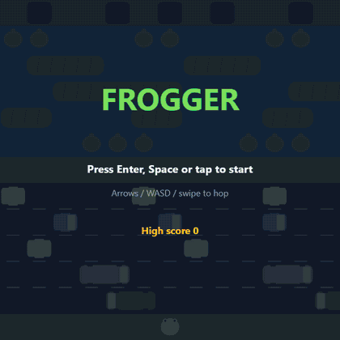

<div align="center">

# 🐸 FROGGER

**A modern, clean-vector take on the 1981 arcade classic, built with TypeScript and HTML canvas.**



_Above: a real run of this game, played by a look-ahead bot (see [`scripts/capture-readme.mjs`](scripts/capture-readme.mjs))._


</div>

---

## The game

Five frogs need to get home. Between them and the lily-pad slots at the top of the screen lie a five-lane highway and a five-lane river. Cars will flatten you, water will drown you, and a 30-second clock is ticking.

Hop across the road, ride logs and turtles over the river, and slot all five frogs home to clear the level. Then do it again, 10% faster.

### Controls

| Input        | Action                                               |
| ------------ | ---------------------------------------------------- |
| Arrows / WASD | Hop one cell                                        |
| Enter / Space | Start game                                          |
| P / Esc      | Pause                                                |
| M            | Mute (audio is on the roadmap)                       |
| Touch        | Swipe to hop, tap to start                           |
| Gamepad      | D-pad or left stick to hop, Start to start / pause   |

### Scoring

| Event                          | Points                  |
| ------------------------------ | ----------------------- |
| Each new furthest row per life | 10                      |
| Frog reaches a goal slot       | 50                      |
| Time left on the clock         | 10 per second           |
| All five slots filled          | 1,000                   |
| Extra life                     | at 20,000 (once)        |

Each level speeds traffic and river up by 10%, capped at 2×. High score is saved in `localStorage`.

## Play it

```bash
git clone https://github.com/ChrisBrooksbank/frogger.git
cd frogger
npm install
npm run dev        # open the printed localhost URL
```

## How it's built

The goal was a codebase that is as pleasant to read as the game is to play.

- **Pure game logic.** Everything in [`src/game/`](src/game) is plain TypeScript with no DOM access: lanes, collisions, river carry, scoring, levels, lives, game flow. It is all unit-tested without a canvas.
- **Deterministic by design.** Fixed-timestep updates with an injectable `dt`, a seeded RNG and freezable animations mean tests and screenshots are repeatable.
- **Thin renderer.** [`src/render/`](src/render) draws everything procedurally on canvas (no image assets), with one theme module holding the whole palette.
- **Input layer.** Keyboard, touch and gamepad are normalised into commands before they reach the game.
- **Built with a Ralph loop.** The game was developed by an autonomous AI-agent loop working through [`specs/`](specs) and [`IMPLEMENTATION_PLAN.md`](IMPLEMENTATION_PLAN.md) one task per fresh-context iteration.

```
src/
├── game/    pure logic (lanes, collision, river, goal, scoring, levels, flow…)
├── input/   keyboard, touch, gamepad → commands
├── render/  canvas drawing, HUD, effects, theme
├── loop.ts  rAF + fixed timestep
└── main.ts  wiring + test hooks (window.__frogger)
```

### Status

Done: core movement, traffic, river, goal slots, scoring, levels, timer, lives, title / pause / game-over flow, high scores, keyboard / touch / gamepad, animations.
Still on the roadmap: diving turtles, crocodiles, snakes, bonus fly and lady frog, WebAudio sound, and the full Playwright interaction and visual-regression suite. See [`IMPLEMENTATION_PLAN.md`](IMPLEMENTATION_PLAN.md).

## Development

```bash
npm run dev            # Vite dev server
npm run build          # tsc + production build into dist/
npm run preview        # serve the production build
npm run test:run       # unit tests (Vitest)
npm run check          # typecheck + lint + format check + unit tests
npm run test:e2e       # Playwright smoke / interaction / visual tests
npm run test:e2e:update  # update visual baselines (only for intended visual changes)
```

The test hooks `?seed=N`, `?manual=1` (you drive time via `window.__frogger.advance()`) and `?frozen=1` make the game scriptable. That is how the GIF above was recorded:

```bash
npm run build && npx vite preview --port 4173 &
node scripts/capture-readme.mjs   # needs ffmpeg
```

Deployment is a static Netlify site (`netlify.toml`, publish `dist`), deployed manually by the owner.

---

## A brief history of Frogger

### Konami, 1981

_Frogger_ (フロッガー) was made by **Konami** and released to arcades in **1981**, the golden year that also gave us _Donkey Kong_, _Galaga_ and _Pac-Man_'s breakout summer. It was designed by **Akira Hashimoto**, working at a company then best known for shooters. Konami's own _Scramble_ came out the same year, and _Frogger_ ran on similar Z80-based hardware (one processor for the game, a second for sound).

The concept was almost a rebuke to the shoot-'em-ups of the day: no weapons, no enemies that fight back, just a small frog trying to get home. The goal is purely to survive the world's traffic, which made it instantly readable to anyone who had ever crossed a road. The game is often credited with helping broaden the arcade audience beyond the usual crowd of teenage boys.

In Japan it was reportedly known in development as a "highway-crossing frog" game, a name that tells you everything about the pitch.

### Sega/Gremlin and the world

In North America, _Frogger_ was distributed by **Sega/Gremlin** and became one of the biggest arcade hits of the early '80s. Home ports followed quickly, including the **Atari 2600** version from Parker Brothers, and it landed on nearly every home computer and console of the era. A sequel, _Frogger II: ThreeeDeep!_, arrived in 1984, and the frog has been hopping through reboots ever since.

### The music

Part of the charm was the sound: a chirpy start jingle, a squelchy splat, a plunk in the water. The tunes are famously stitched together from Japanese children's songs. The opening is built around _Inu no Omawarisan_ ("The Dog Policeman"). Strange, cheerful music for a game about dying in traffic.

### Rules that stuck

The original packs a lot into one screen, and nearly every rule survived into later "crossing" games:

- **Five home slots** at the top, with a wall between them. Miss a slot and you die.
- **Rivers you must not touch.** Logs and turtles are safe, but you drift with them, and they can carry you off-screen.
- **Diving turtles** that sink on a timer and drown the unwary.
- **Crocodiles** whose backs are safe but whose open jaws are not, and which sometimes lurk inside a home slot.
- **Snakes** on the median and on logs.
- **Bonus critters**: a fly in a slot and a lady frog riding a log, both worth 200 points.
- **A hurry-up timer** that pushes you to take risks.

### Seinfeld and pop culture

_Frogger_ got an unlikely second life in 1998 when it starred in the _Seinfeld_ episode **"The Frogger"**. George Costanza learns his old high score is still on the machine at a pizza parlour and goes to absurd lengths to preserve it, ending with him trying to carry the whole cabinet across a busy street. Which is, of course, the premise of the game.

### The legacy

You can draw a straight line from _Frogger_ to modern endless-crossing hits like **_Crossy Road_** (2014), whose hopping animals are an open homage. The core idea, hop on a grid, read the traffic, commit, is still one of the cleanest bits of game design ever made.

> _History section written from memory of widely reported accounts; details such as exact release dates differ slightly between sources, and Konami and Sega/Gremlin dates vary by region._

## Acknowledgements

_Frogger_ is a trademark of Konami. This is an unofficial fan-made tribute with all-original, procedurally drawn art, and is not affiliated with or endorsed by Konami or Sega.

## License

[MIT](LICENSE) © Chris Brooksbank
